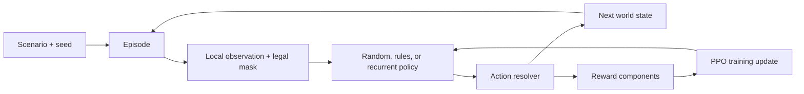

# How Level 1 works

One community chooses an action, experiences its consequences, and receives an outcome-based reward. During training, recurrent PPO adjusts neural-network weights across many episodes. During evaluation the weights stay fixed while GRU memory evolves within each episode.



## File responsibilities

| File | Purpose |
|---|---|
| `environment/models.py` | Immutable positions, resources, community state, technology progress, and world configuration. |
| `environment/technology.py` | Four technology definitions, prerequisite validation, research eligibility, effect multipliers, and maintenance costs. |
| `environment/actions.py` | Action objects, fixed action-index mapping, and masks. PPO outputs an index into this catalog. |
| `environment/world.py` | Deposits, boundaries, visibility, legality, passive regeneration, and episode state. |
| `environment/resolver.py` | Applies action costs/effects, maintenance, food consumption, population loss, decay, and time advancement. |
| `environment/scenarios.py` | Reproducible initial worlds. Stable and scarcity are parameter presets. Scarcity currently starts sparse; no timed drought exists yet. |
| `environment/observations.py` | Turns permitted information into 128 named features for the starter graph and radius 2. Hidden deposits never enter this vector. |
| `environment/rewards.py` | Scores population retention, shortages, and population loss. Components are logged separately. No bonus for choosing a technology. |
| `environment/episode.py` | Owns reset/step, coordinates simulation and rewards, and runs complete episodes with an agent. |
| `environment/rl_environment.py` | Gymnasium adapter with numerical arrays, spaces, masks, and termination/truncation flags. Requires optional dependencies. |
| `baseline_agents.py` | Random legal choices and a heuristic survival/research policy. Both receive the same observation as RL. |
| `rl_policy.py` | Dense encoder, 128-unit GRU, masked action distribution, value estimate, checkpoint contract, and evaluation agent. |
| `train.py` | On-policy recurrent PPO rollout collection, generalized advantage estimation, clipped objective, gradient updates, CSV logging, and checkpoint saving. |
| `evaluate.py` | Paired held-out seeds, baseline/RL comparisons, optional research-enabled versus disabled ablation, full per-run traces, metrics, fixed-seed replay, and a browser report. |
| `tests/test_level1.py` | Integration tests for reproducibility, hidden-information isolation, accounting, legal actions, episode completion, and optional RL behavior. |
| `pyproject.toml` | Package installation and optional RL dependencies. Python 3.11+ is required for StrEnum. |
| `.gitignore` | Keeps caches, environments, temporary renders, and training/evaluation output out of Git. |
| `__init__.py` files | Define Python packages and the implementation version. |

## What the agent sees

The 128 features are: eight self features (position, time, population, labor, three inventories), eight technology features (progress and activity for four nodes), 100 neighborhood features (a 5x5 window with visibility and three resource amounts per cell), and twelve previous-action flags. Cells outside Manhattan radius 2 are masked even though they lie inside the square window. The action mask is delivered separately. Inventories and deposits use the fixed transformation amount/(amount+30), preserving ordering while keeping values below one.

The baseline reads these same named features. It cannot inspect distant deposits. The policy must retain exploration history in its GRU; the simulation does not pass global resource maps or the random seed to it.

## Action and reward sequence

An action is checked against the mask before execution. The resolver executes it, pays technology maintenance in prerequisite order, consumes food, reduces population for shortages, applies inventory decay, regenerates deposits, and advances time. Research costs are paid once; labor is an eligibility requirement on every experiment. Discovery progresses deterministically. Technologies automatically resume when their maintenance and prerequisites can be supported.

The reward is:

```text
population / starting_population
- 0.5 * shortage / max(1, starting_population * 0.05)
+ 2 * population_change / starting_population
```

This is a provisional objective. It rewards preserving a healthy community and penalizes deprivation. It contains no direct research bonus. Population growth and explicit wasted-labor accounting are not implemented. Gathering requires positive labor but its current yield does not scale with labor. Proficiency is reserved in the state model and has no effect yet.

## How learning works

The policy samples only legal actions. PPO collects fresh complete episodes, calculates advantages, and recomputes full ordered sequences starting with empty GRU memory. It does not shuffle individual timesteps. Gradient clipping stabilizes updates; entropy encourages exploration. True collapse uses zero bootstrap value, while the time limit bootstraps the final state's value estimate. There is no policy-weight update during demonstration or evaluation.

Checkpoint contracts include feature names, action labels, technology definitions, world/scenario configuration, resolver parameters, and reward weights. Changes to those fields cause evaluation to reject the checkpoint rather than silently apply an incompatible policy. Checkpoints are final policy snapshots; optimizer resume and vectorized training are future improvements.

## What counts as success

Passing tests and executing PPO demonstrate a functioning implementation. They do not prove that RL learns a useful strategy. Train beyond the smoke run, compare held-out seeds, repeat with multiple training seeds, inspect shortages, retained population, discoveries, and failure replays. A barely positive population is not a meaningful survival victory; report population retained alongside termination. The baseline and trained policy need not discover every technology. Technologies must improve outcomes under the chosen environment to be worth learning.

Stable and scarcity starts guarantee accessible food and nearby materials. This is an initial curriculum convenience, not a random-start generalization test. The numerical balance has not been tuned to ensure the rule agent preserves all population or RL beats it. The sequential Python engine is an inspectable reference implementation, not yet a high-throughput GPU simulator.

## Local commands

Use the setup and commands in README.md. The Gymnasium adapter expects callers to respect `action_masks()`; a generic algorithm that samples every Discrete action without masking will receive illegal-action errors. Evaluation seed 10000 onward is reserved by default; increase it if a training run uses that range.

Use `--technology-ablation` to add `rules_no_research`, the same yield-aware rule strategy with all experiment choices suppressed. The evaluator records identical seeds, configuration, summary metrics, every full run, and paired enabled-minus-restricted differences. This tests the net value of the strategy's research decisions; it does not change the environment's technology graph or isolate one node at a time.

No remote publication is part of Level 1 completion. Existing proposals and presentation assets remain in the workspace.

## Verification on October 5, 2026

All nine tests passed with optional dependencies installed into a project-local temporary directory. A CPU PPO smoke run used two updates, two episodes per update, and two optimization epochs; training, checkpoint saving, and loading for evaluation succeeded.

Five held-out seeds (10000–10004) produced these measured final population-retention means:

| Environment | Random | Rule-based | RL smoke model |
|---|---:|---:|---:|
| Stable | 0% | 36.04% | 0.28% |
| Scarcity | 0% | 13.91% | Not evaluated |

The tiny smoke model has not learned a reliable strategy. Rule agents discovered no technologies on this sample. These runs establish execution and expose balance/heuristic limitations; they are not evidence that RL beats either baseline. Current reports live in `results/stable_review`, `results/scarcity_review`, and `results/ppo_review`; the smoke checkpoint and learning CSV are in `results/ppo_smoke`.
